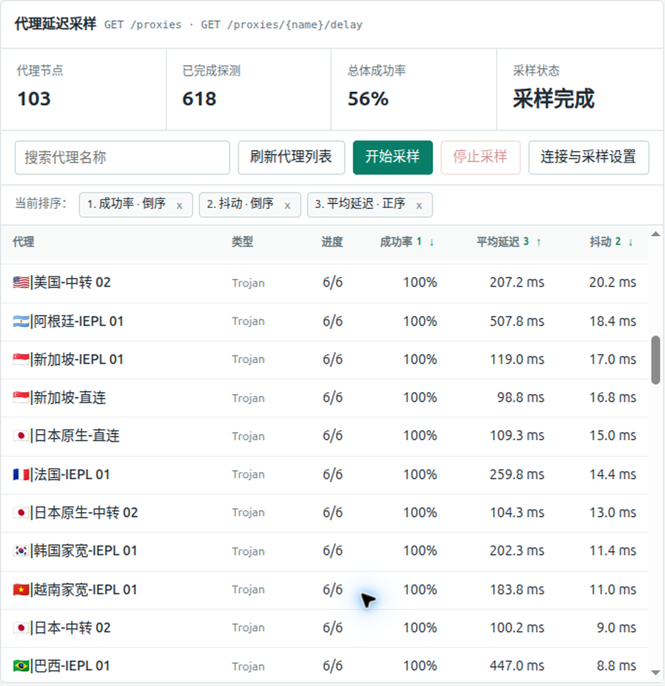

# FlClash Proxy Stability Finder

FlClash 代理稳定性筛选器是一个独立于 FlClash 的本机代理延迟采样工具，帮助你从多个节点中找出更稳定的选择。它会对当前代理列表进行多轮并发探测，并以成功率、平均延迟和延迟抖动评估节点稳定性，而不只依据某一次测速结果排序。

除延迟采样外，工具还提供出口 IP 探测、服务可达性、控制器流量、活动连接和运行日志观测；不修改 FlClash 项目，也不需要第三方 Python 包。

## 界面预览



## 核心能力

- 多轮并发采样当前代理列表，减少单次网络波动带来的误判。
- 按成功率、平均延迟和抖动比较节点，优先识别连接更可靠、时延更平稳的节点。
- 可按成功率或抖动排序，快速筛选成功率更高、网络波动更小的稳定节点。
- 支持搜索、停止采样和调整探测 URL、轮数、间隔、并发数与超时。

## 准备工作

需要 Python 3.10 或更新版本，无需安装第三方 Python 包或 Tkinter。

在 FlClash 中完成以下配置：

1. 开启“外部控制器”，监听地址使用本机回环地址 `127.0.0.1`，并设置外部控制器端口（默认 `9090`）。不要将控制器暴露到局域网或公网。
2. 记下 FlClash 配置的控制器密钥。启动本项目后，在页面的“控制器地址”中填写与 FlClash 端口一致的地址，例如 `http://127.0.0.1:9090`；在“控制器密钥”中填写对应密钥，然后保存。
3. 也可以直接编辑 `config/config.json` 中的 `controller` 和 `secret` 字段。刷新代理列表后，项目即可读取 FlClash 暴露的节点，并通过其延迟测试接口对节点进行采样。

控制器密钥以明文保存在本机配置文件中；该文件已加入 Git 忽略规则，并会按当前系统支持的方式限制为仅当前用户可读写，请勿分享。

## 启动应用

运行启动脚本：

```bash
./scripts/start.sh
```

脚本只启动监听 `127.0.0.1` 的本机 Web 服务，不会自动打开浏览器。手动访问 `http://127.0.0.1:8765` 使用界面；按 `Ctrl+C` 关闭服务。

## 其他功能

除代理延迟采样外，Web 界面还展示控制器流量、活动连接和运行日志，并提供出口 IP 与服务可达性探测。出口 IP 探测提供四个服务按钮，每次仅请求所点选的服务；可达性模块默认探测 Google、GitHub 和百度，也可添加或删除自定义目标。两种探测均默认直连，也可分别切换为 Python 默认网络配置。

## 项目结构

- `app/`：延迟采样、控制器观测和本机 Web 界面。
- `config/config.json`：本地控制器地址和密钥配置，已加入 Git 忽略规则。
- `config/config.example.json`：不含密钥的配置模板。
- `scripts/`：启动脚本。

## 测试

```bash
python3 -m unittest discover -s tests -v
```
